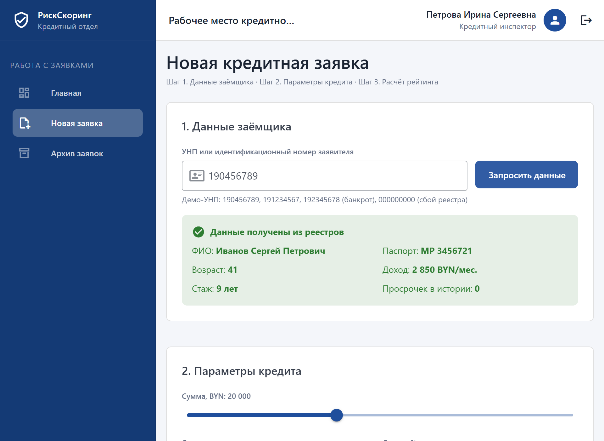
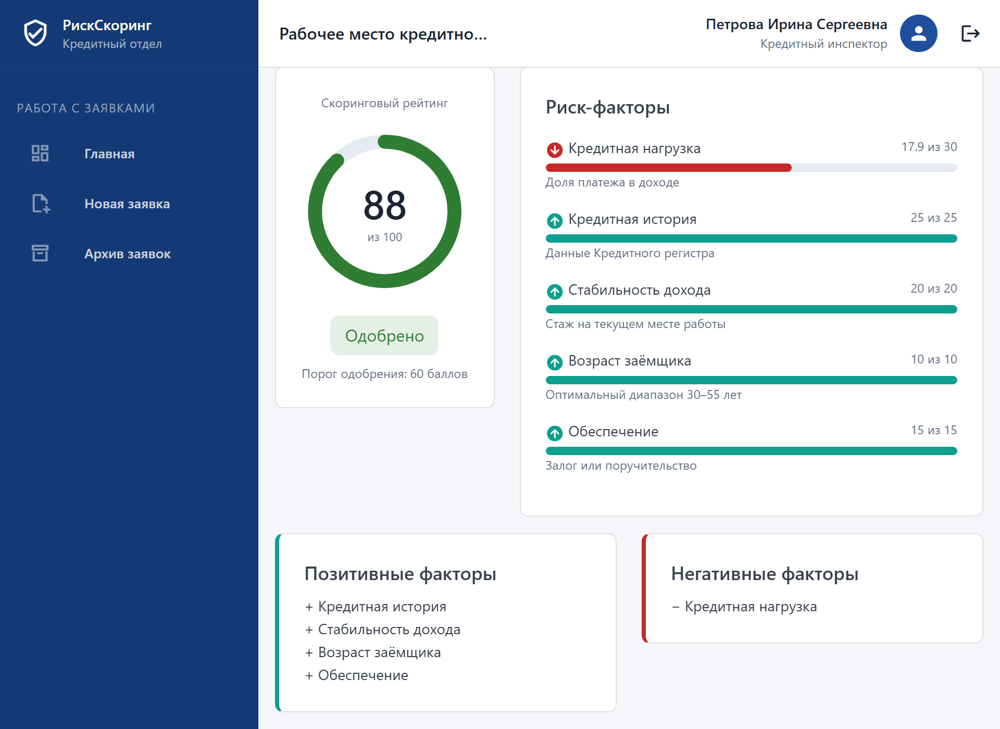
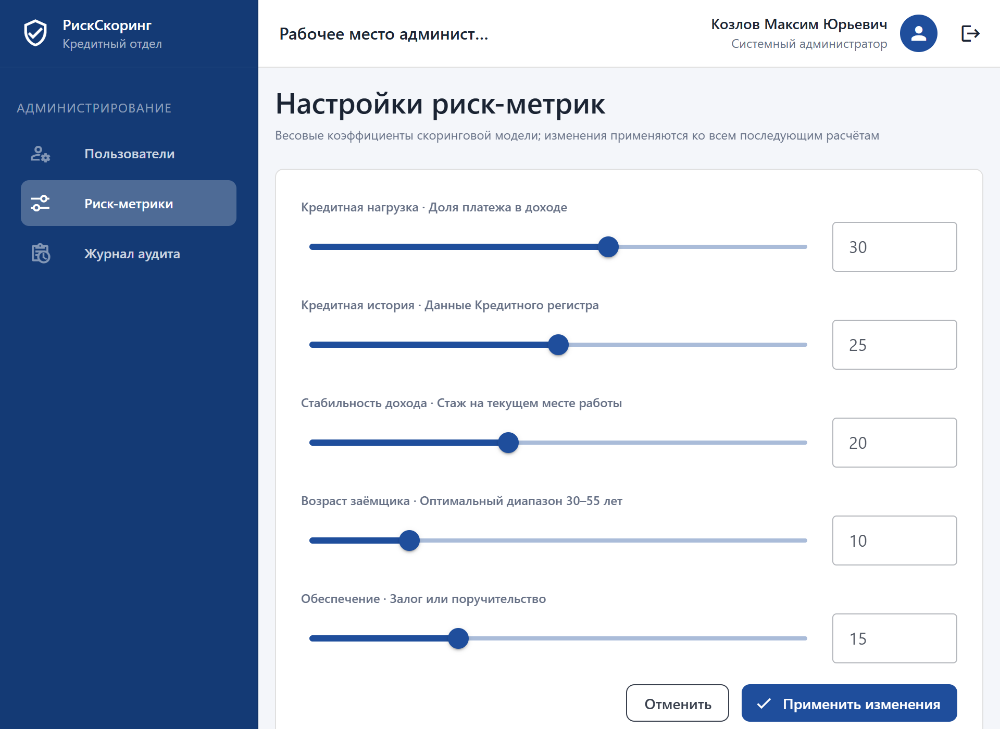
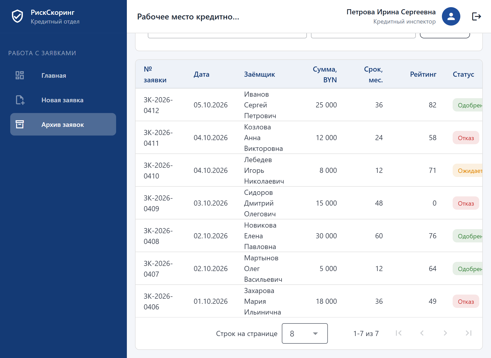

# РискСкоринг: клиентская часть

Клиентское приложение платформы анализа рисков кредитования физических лиц. Учебный проект по дисциплине «Технологии проектирования сложных информационных систем» (БГУИР, группа 314302), лабораторная работа № 6 «Проектирование и разработка пользовательского интерфейса программного средства».

Серверная часть (REST API на Python/FastAPI, PostgreSQL) разрабатывается на следующих этапах; пока обращения к реестрам (МВД, Кредитный регистр), архив заявок, список пользователей и журнал аудита имитируются тестовыми данными (`src/stores/mock.js`).

## Возможности

Кредитный инспектор:
- вход в систему, главная страница со сводкой и последними заявками;
- создание заявки: запрос данных заёмщика из реестров (три попытки при сбое), параметры кредита, аннуитетный платёж;
- расчёт скорингового рейтинга по настраиваемым весам, позитивные и негативные риск-факторы, стоп-фактор «банкротство»;
- пакет кредитной документации с графиком платежей;
- архив заявок с поиском и фильтром по статусу, карточка заявки с историей статусов.

Системный администратор:
- управление пользователями (создание профиля, блокировка и разблокировка);
- настройка риск-метрик (веса скоринговой модели с проверкой допустимых значений);
- журнал системного аудита с фильтрами.

Интерфейс адаптивный: на планшете меню скрывается, на телефоне таблицы заменяются карточками. Страница с эталонными элементами системы дизайна: `/#/design-system`.

## Технологии

Vue 3 (Composition API), Vite, Vue Router, Vuetify 3 (Material Design), Material Design Icons.

## Запуск

```bash
npm install
npm run dev        # http://localhost:5173
npm run build      # сборка в dist/
```

Тестовые учётные записи (пароль любой от 4 символов): `i.petrova` – кредитный инспектор, `admin` – системный администратор. Демо-УНП для запроса данных: `190456789`, `191234567`, `192345678` (банкротство), `000000000` (имитация сбоя реестра).

## Структура

| Путь | Назначение |
|---|---|
| `src/theme.js`, `src/styles.css` | цветовые токены, типографика, общие стили |
| `src/router/index.js` | маршруты и защита страниц по роли |
| `src/stores/state.js` | общее состояние: пользователь, веса, заявки, журнал |
| `src/stores/scoring.js` | вычислительное ядро скоринга, аннуитет |
| `src/stores/mock.js` | имитация реестров и тестовые данные |
| `src/views/` | экраны приложения и страница системы дизайна |
| `src/components/StatusChip.vue` | метка статуса заявки |

## Ветки

- `main` – рабочая версия;
- `develop` – разработка (серверная часть и интеграция добавляются здесь).

## Скриншоты

| Новая заявка | Результат скоринга |
|---|---|
|  |  |

| Настройка риск-метрик | Архив заявок |
|---|---|
|  |  |
